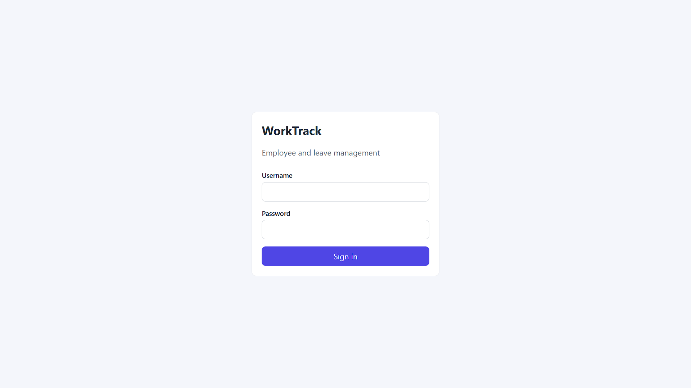
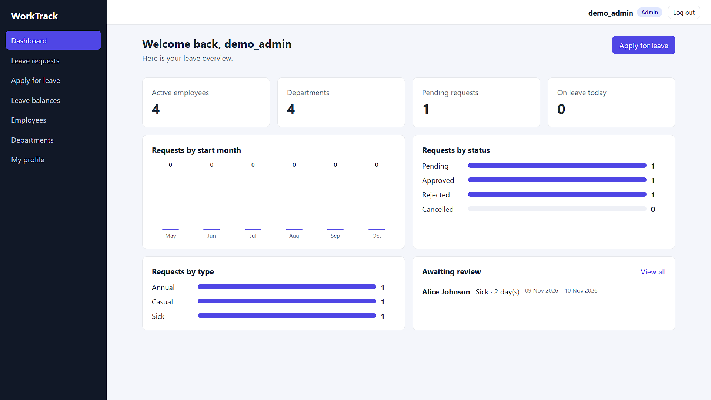
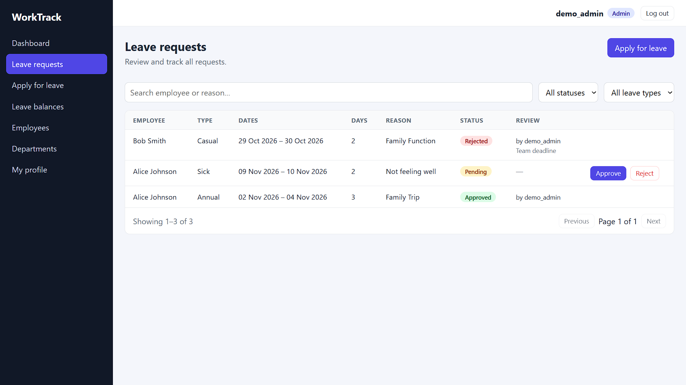
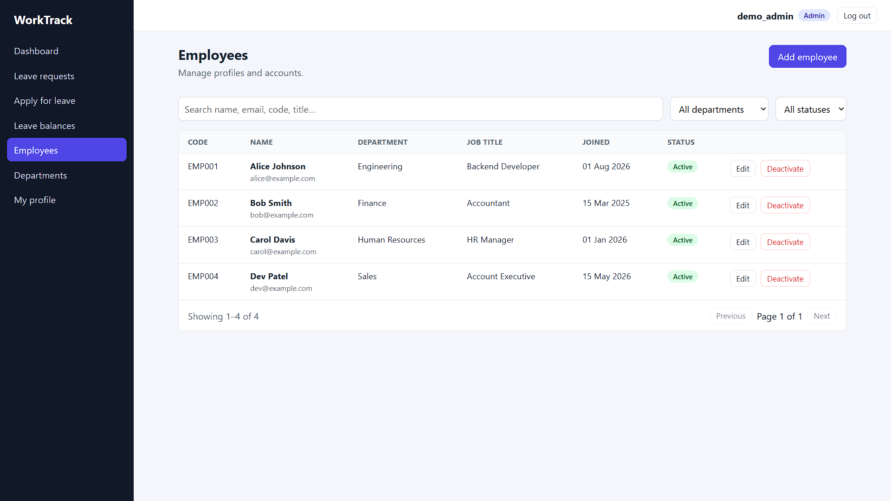
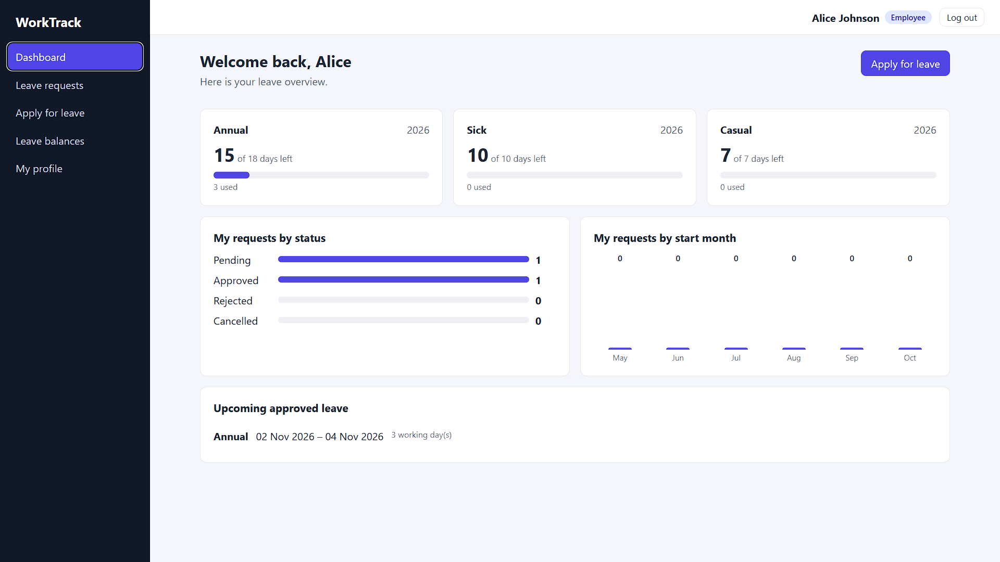

# WorkTrack — Employee & Leave Management System

A full-stack web app where admins manage employees and departments, and employees apply for leave and track their balances. Built with Django REST Framework, React + TypeScript and PostgreSQL.

**Live demo:** https://worktrack-kt.vercel.app
**API docs (Swagger):** https://worktrack-api-4vdm.onrender.com/api/docs/

> The backend runs on a free Render instance, so the first request after a period of inactivity can take up to a minute.

### Demo accounts

| Role | Username | Password |
|---|---|---|
| Admin | `demo_admin` | `Demo@Admin2026!` |
| Employee | `alice` | `Employee@2026!` |

These are throwaway accounts with fake data. Please don't enter real personal information.

## Screenshots

| Login | Admin dashboard |
|---|---|
|  |  |

| Leave requests | Employees |
|---|---|
|  |  |



## Features

- JWT authentication with Admin and Employee roles, enforced on the server
- Employee profiles and department management (a department with employees cannot be deleted)
- Leave applications with approve, reject and cancel, working-day calculation (Mon–Fri) and per-year balances
- Role-specific dashboards (admin: totals, trends, pending queue; employee: balances, upcoming leave)
- Search, filtering, ordering and pagination on every list
- Server-side validation, database constraints and one consistent error format
- Responsive UI with loading, error and empty states
- 39 automated backend tests and OpenAPI documentation, with CI on every push

## Tech stack

| Layer | Tools |
|---|---|
| Backend | Python, Django 5.2, Django REST Framework, SimpleJWT, django-filter, drf-spectacular |
| Frontend | React, TypeScript, Vite, React Router, Axios |
| Database | PostgreSQL |
| Testing and tools | pytest, pytest-django, Postman, Git, GitHub Actions |
| Hosting | Render (API and database), Vercel (frontend) |

## Architecture

```
React + TS (Vite)  --HTTP/JSON + JWT-->  Django REST API  -->  PostgreSQL
```

Django apps: `accounts` (users and auth), `employees` (departments and profiles), `leaves` (types, balances, requests, with business rules in `services.py`) and `dashboard` (statistics).

```
worktrack/
├── backend/    Django project (config/, apps/, tests next to each app)
├── frontend/   React + TypeScript (src/api, context, hooks, components, pages)
├── docs/       OpenAPI schema, Postman collection, screenshots
└── .github/    CI workflow
```

## Quick start (Windows PowerShell)

Prerequisites: Python 3.11+, Node.js 20.19+, PostgreSQL 15+, Git.

```powershell
# 1. Database (adjust the PostgreSQL version in the path)
$env:Path += ";C:\Program Files\PostgreSQL\16\bin"
psql -U postgres -h localhost -c "CREATE USER worktrack_user WITH PASSWORD 'change_me_strong' CREATEDB;"
psql -U postgres -h localhost -c "CREATE DATABASE worktrack_db OWNER worktrack_user;"

# 2. Backend
cd backend
python -m venv .venv
.\.venv\Scripts\Activate.ps1
pip install -r requirements-dev.txt
Copy-Item .env.example .env        # then set SECRET_KEY (and DB_PASSWORD if you changed it)
python manage.py migrate
python manage.py seed_demo         # demo departments, employees and leave requests
python manage.py runserver

# 3. Frontend (second terminal)
cd frontend
npm install
Copy-Item .env.example .env.local
npm run dev
```

Open http://localhost:5173 (use `localhost`, not `127.0.0.1`, because of CORS).
`seed_demo` is idempotent and creates the demo accounts listed above. Set `DEMO_ADMIN_PASSWORD` and `DEMO_EMPLOYEE_PASSWORD` to use different passwords, or run it with `--reset-passwords` to reset them.

## Environment variables

See `backend/.env.example` and `frontend/.env.example`.

| Variable | Purpose |
|---|---|
| `SECRET_KEY`, `DEBUG`, `ALLOWED_HOSTS` | Core Django settings |
| `DATABASE_URL` (or `DB_*`) | PostgreSQL connection |
| `CORS_ALLOWED_ORIGINS`, `CSRF_TRUSTED_ORIGINS` | Allowed frontend and API origins |
| `VITE_API_URL` | API base URL, baked into the frontend at build time |

## Tests

```powershell
cd backend
pytest
```

The database user needs `CREATEDB` because pytest creates `test_worktrack_db`. GitHub Actions runs the backend tests against PostgreSQL, plus the frontend lint and build, on every push.

## API documentation

- Swagger UI: `/api/docs/` · schema: `/api/schema/` · static copy: [`docs/openapi.yml`](docs/openapi.yml)
- Postman collection: [`docs/WorkTrack.postman_collection.json`](docs/WorkTrack.postman_collection.json)

| Area | Endpoints |
|---|---|
| Auth | `POST auth/login/`, `auth/refresh/`, `auth/logout/`, `GET auth/me/`, `POST auth/change-password/` |
| Org | `departments/`, `employees/` (+ `employees/me/`) |
| Leaves | `leave-types/`, `leave-balances/`, `leave-requests/` (+ `POST {id}/approve/`, `reject/`, `cancel/`) |
| Stats | `GET dashboard/` |

Lists return `{count, next, previous, results}` and accept `page`, `page_size`, `search`, `ordering` plus endpoint-specific filters. Errors always look like `{"error": {"code", "message", "details"}}`.

## Deployment

- **API and database:** Render web service (root `backend`, `gunicorn config.wsgi:application`) with a Render PostgreSQL database. The build step runs `collectstatic` and `migrate`, and can optionally seed demo data when `SEED_DEMO=true`.
- **Frontend:** Vercel (root `frontend`) with `VITE_API_URL` set to the API URL. `vercel.json` rewrites all routes to `index.html` so React Router paths survive a refresh.
- Production settings (secure cookies, SSL redirect, HSTS) switch on when `DEBUG=False`.

## Design decisions

- **Server-enforced roles:** DRF permission classes protect every endpoint. Frontend route guards are UX only.
- **Business rules in a service layer:** approval and cancellation run in transactions with row locks, so balances cannot go negative or be double-deducted.
- **Database constraints:** unique keys, `end_date >= start_date` and `used_days <= total_days`.
- **Pending requests reserve balance** at apply time. Days are deducted on approval and refunded when approved leave is cancelled.
- **Soft delete for employees:** deactivation blocks login but keeps leave history.
- **Single error envelope**, so the frontend needs only one error parser.
- **Token refresh:** one shared refresh call, with a retry of the original request.

## Limitations and future work

- No public-holiday calendar; leave days are Mon–Fri.
- Tokens are stored in `localStorage`; an httpOnly refresh-token cookie would be stronger.
- Changing a password does not revoke existing refresh tokens.
- Login throttling uses Django's per-process cache; use Redis for multi-instance deployments.
- The frontend has no automated tests, only type-checking, linting and a build in CI.
- Ideas: email notifications, half-day leave, calendar view, CSV export.